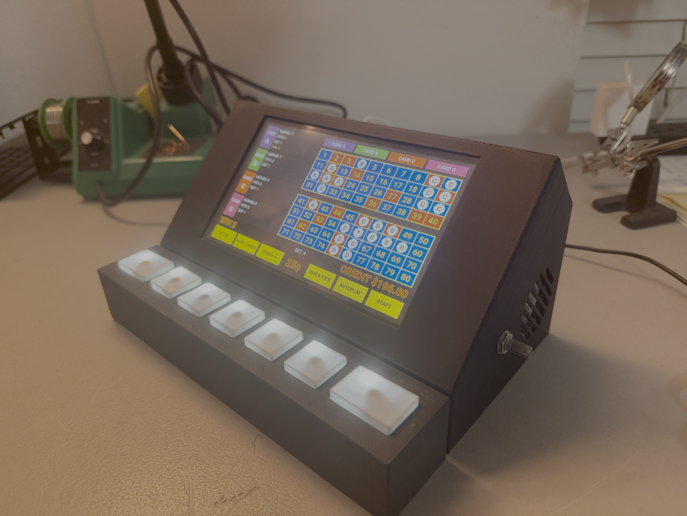
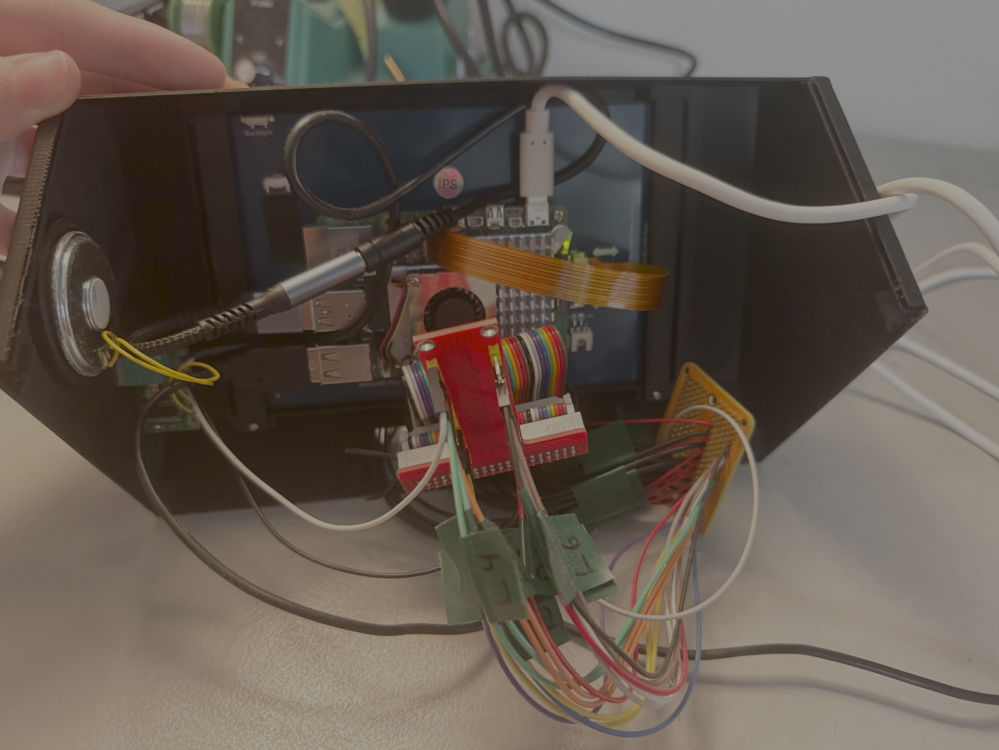
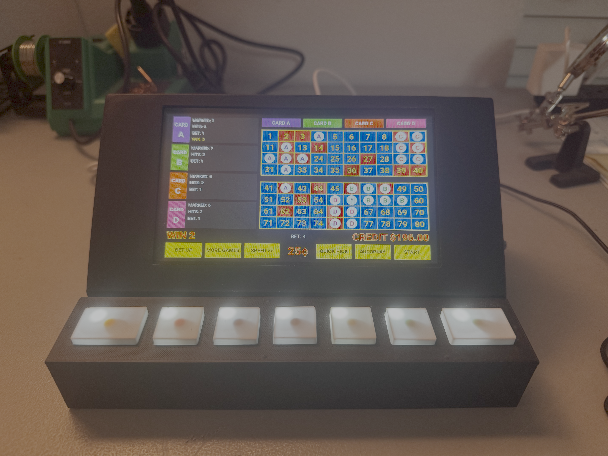

# Raspberry Pi Keno Machine

A standalone four-card Keno machine built with a Raspberry Pi 5, Python, Kivy, and custom GPIO-connected hardware.



## Overview

This project is a physical Keno gaming system built around a Raspberry Pi 5. I designed the touchscreen interface and game logic in Python, then integrated the software with physical buttons, LED indicators, audio hardware, and a custom enclosure.

The goal was to build a complete standalone device rather than a software-only recreation. The project involved Linux configuration, GPIO integration, soldering and wiring, audio output, enclosure fabrication, and troubleshooting across both the hardware and software.

## Features

- Four independently configurable Keno cards
- 80-number touchscreen board with 20-number randomized draws
- Per-card number selection, betting, hit tracking, and payouts
- Physical controls connected through Raspberry Pi GPIO
- LED status feedback
- Quick Pick and Autoplay
- Multiple game speeds
- Credit, bet, win, and payout tracking
- Audio feedback for drawn numbers
- Custom touchscreen interface built with Kivy

## Hardware

The system is built around a Raspberry Pi 5 and combines touchscreen controls with a separate physical control panel.

Physical buttons and LEDs are wired through a GPIO breakout and a soldered prototyping PCB. Audio is routed from the Raspberry Pi through a USB audio connection to a PAM8403 amplifier, with an additional connection from the GPIO breakout to the amplifier circuitry.

```text
Raspberry Pi 5
|
|-- Touchscreen Display
|
|-- GPIO Breakout
|   |
|   |-- Soldered PCB
|   |   |-- Physical Buttons
|   |   `-- LEDs
|   |
|   `---------------------------------
|                                     |
|                                     V
`-- USB Audio ----------------> PAM8403 Amplifier
                                      |
                                      `-- Speaker
```



The enclosure and control panel were custom designed and 3D printed. The electronics were assembled and wired by hand, including the GPIO connections, button and LED wiring, and audio circuitry.

## Software

The application is written in Python and runs on Linux on the Raspberry Pi.

- **Kivy** provides the touchscreen interface and event-driven UI.
- **gpiozero** handles the physical GPIO buttons and LEDs.
- **pygame** provides audio playback.
- Kivy's `Clock` is used to coordinate physical input, number drawing, animations, payouts, and autoplay without blocking the interface.

The game generates 20 unique numbers from 1-80 for each draw and evaluates the selected numbers on each active card against a payout table. The same game functions can be triggered through the touchscreen interface or the corresponding physical controls.

## Physical Build

The finished machine uses a dedicated display enclosure and a separate seven-button control panel. The physical controls mirror core functions available in the touchscreen interface, allowing the device to be operated more like a dedicated gaming machine than a standard Raspberry Pi application.



## Running the Project

The software was developed specifically for the Raspberry Pi hardware used in this build and expects the configured GPIO devices to be available.

Install the Python dependencies:

```bash
pip install -r requirements.txt
```

Run the application:

```bash
python3 keno_machine.py
```

The GPIO pin assignments are currently defined directly in `keno_machine.py`. Running the application on hardware with a different wiring configuration will require updating those assignments.

## Repository

```text
RaspberryPi-Keno-Machine/
|-- README.md
|-- keno_machine.py
|-- requirements.txt
|-- .gitignore
`-- images/
    |-- image1.png
    |-- image2.png
    `-- image3.png
```

This repository contains the software from the completed physical build. It is intended primarily as documentation of the project rather than as a universal Keno application or step-by-step hardware build guide.
